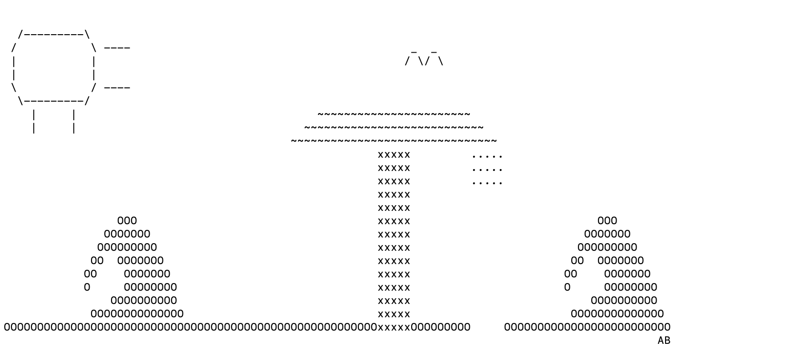
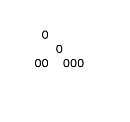
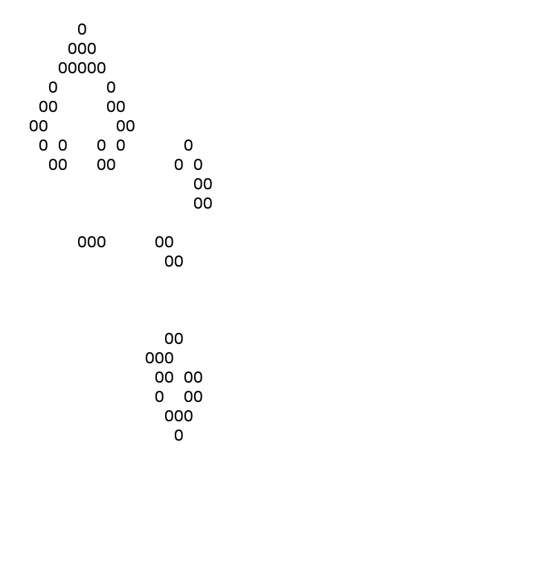

CITATION LEVELS
--------------
(It's all level one)
I did all the art with my imagination.
For conways game of life, the methuselah start I got from here:
https://conwaylife.appspot.com/pattern/acorn 

The pattern is called acorn. It was discovered by Charles Corderman.
      
Beach:



Wave:
```                 
      OOO        
    OOOOOOO      
   OOOOOOOOO     
  OO  OOOOOOO    
 OO    OOOOOOO   
 O     OOOOOOOO  
     OOOOOOOOOO  
  OOOOOOOOOOOOOO 
OOOOOOOOOOOOOOOOO
```


Game of Life:
Starting generation -



Random generation -




